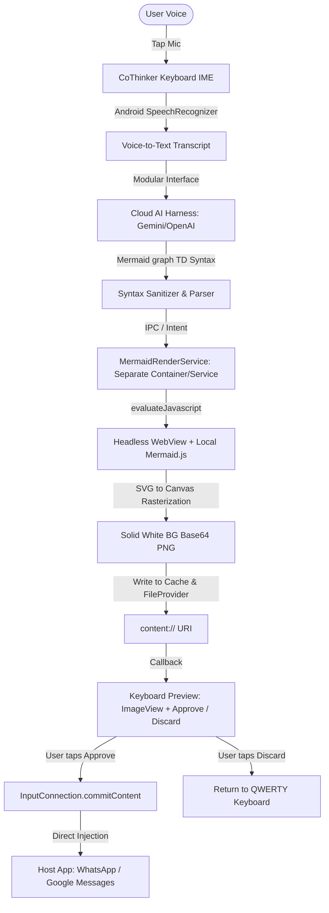

# PLAN.md: Voice-to-Diagram Feature for CoThinker (Android Prototype)

## 1. Objective & Scope
Execute a 72-hour hackathon-style sprint to build and demonstrate a standalone Android Keyboard ("CoThinker") proof-of-concept that captures voice dictation, generates Mermaid.js flowcharts via an AI harness, renders them into PNG diagrams via a headless WebView, and directly injects them into messaging apps (WhatsApp & Google Messages) using Android's `CommitContent` API.

* **Target OS:** Android Only (Native Kotlin). iOS is deferred post-hackathon.
* **Target Host Apps:** WhatsApp, Google Messages.
* **Codebase:** Standalone green-field Android project created in this workspace.

---

## 2. System Architecture



### Component Breakdown
1. **IME Process (`CothinkInputMethodService`):**
   - Lightweight custom keyboard with QWERTY layout, Mic button, and preview overlay.
   - Houses the `SpeechRecognizer` listener.
   - Shows thumbnail preview of generated diagram with **Approve (Green)** and **Discard (Red)** actions.
   - Executes `InputConnection.commitContent()` with appropriate `EditorInfo` MIME-type validation (`image/png`).
2. **AI Harness Module (`DiagramGenerator` interface):**
   - Clean abstraction: `generateDiagram(transcript: String): Result<String>`.
   - Initial implementation: Cloud API (Gemini / OpenAI) with strict few-shot prompting for `graph TD`.
   - Built to be seamlessly swapped with on-device ExecuTorch / MediaPipe later.
3. **Decoupled Rendering Engine (`MermaidRenderService`):**
   - Isolated from IME memory to prevent OOM/crashes.
   - Loads offline local `mermaid.min.js` in a headless WebView.
   - Forces solid white background (`#FFFFFF`) with black strokes/text for dark-mode compatibility.
   - Renders SVG onto `<canvas>` and exports high-res Base64 PNG.
4. **Content Provider & Handoff:**
   - Saves PNG to cache directory.
   - Generates `content://` URI via Android `FileProvider`.
   - Grants temporary read URI permission (`FLAG_GRANT_READ_URI_PERMISSION`).

---

## 3. Sprint Execution Roadmap

### Day 1: Scaffolding, IME UI, & Speech-to-Text
* **Task 1.1: Android Project Scaffolding**
  * Setup Gradle project with Android SDK (minSdk 26, targetSdk 34, Kotlin).
  * Configure `AndroidManifest.xml` with `BIND_INPUT_METHOD`, `RECORD_AUDIO`, and `FileProvider`.
* **Task 1.2: Basic Keyboard IME & Mic UI**
  * Implement `CothinkInputMethodService` with simple QWERTY view and microphone button.
  * Integrate Android's native `SpeechRecognizer` to capture real-time dictation text.
* **Task 1.3: Modular AI Harness & Prompt Engineering**
  * Define `DiagramGenerator` contract.
  * Implement Gemini/OpenAI cloud-backed client with few-shot system prompt restricted to `graph TD`.
  * Add regex sanitizer to strip conversational filler and markdown blocks (` ```mermaid `).

### Day 2: Offline WebView Renderer & IPC Pipeline
* **Task 2.1: Local Mermaid Assets**
  * Bundle `mermaid.min.js` and a minimal local bridge HTML file inside `assets/`.
* **Task 2.2: Isolated MermaidRenderService**
  * Create service/headless WebView pipeline to execute Javascript.
  * Implement JS Canvas rasterizer: `SVG -> Image -> <canvas> (solid #FFF fill) -> toDataURL('image/png')`.
* **Task 2.3: IPC & FileProvider Caching**
  * Connect IME to `MermaidRenderService` via IPC / Coroutine service binding.
  * Save Base64 decoded bytes into `cacheDir/diagrams/`.
  * Return `content://` URI via `FileProvider`.

### Day 3: Diagram Preview & CommitContent Injection
* **Task 3.1: Keyboard Preview Overlay**
  * Create preview layout: swap QWERTY view for diagram `ImageView`.
  * Add Green "Approve" and Red "Discard" buttons.
* **Task 3.2: Android `commitContent` Implementation**
  * Check `EditorInfoCompat.getContentMimeTypes(editorInfo)` for `image/png`.
  * Call `InputConnectionCompat.commitContent()` with `InputContentInfoCompat`.
  * Handle fallback toast / clipboard if host app lacks rich content support.
* **Task 3.3: Verification on WhatsApp & Google Messages**
  * Validate end-to-end flow: Voice -> Transcript -> Diagram -> Preview -> Direct Injection into WhatsApp and Google Messages.

---

## 4. Deliverables for the Founder
1. **Working APK Prototype:** Sideloadable build demonstrating direct diagram injection in WhatsApp & Google Messages.
2. **System Prompt & Sanitizer Module:** Tested few-shot prompt definitions and regex cleaners.
3. **Modular Architecture Document:** Documentation of the decoupled `DiagramGenerator` (ready for future ExecuTorch on-device swap) and memory-isolated `MermaidRenderService`.
